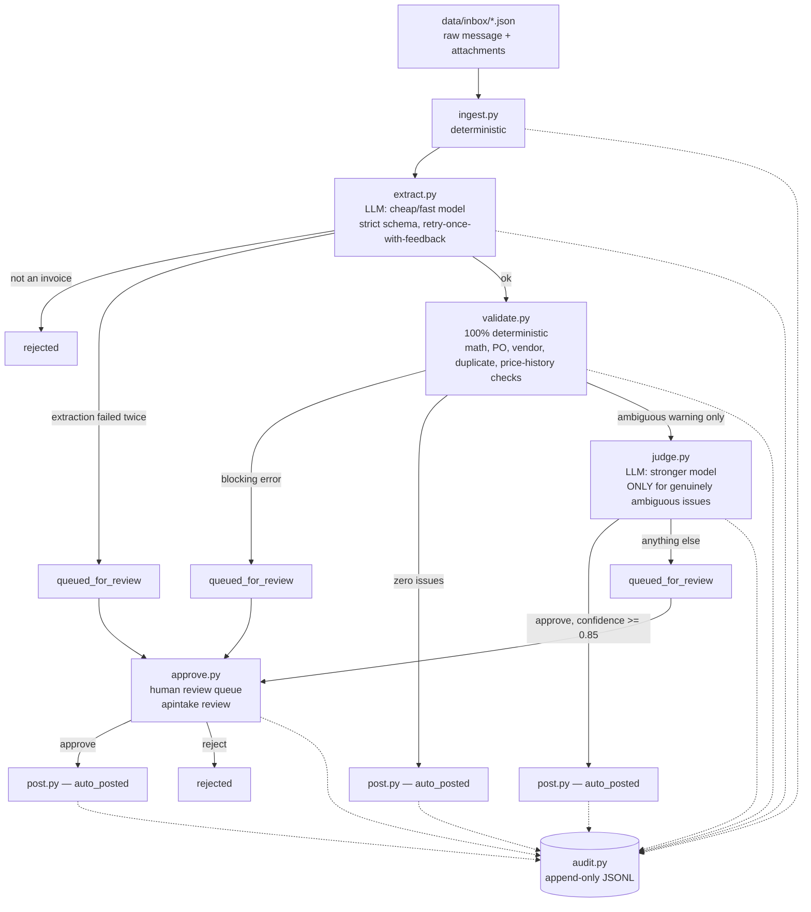

# apintake — AP Invoice Intake Agent

A Forward-Deployed-Engineer portfolio demo: an accounts-payable invoice-intake agent built
around one thesis — **most of a good AI system is deterministic code; the LLM only belongs
at genuine judgment points; and a human approves anything the system can't confidently
resolve itself.** Full audit trail, strict schemas, and an eval harness with a golden
dataset are the proof that this isn't a demo that only works on the happy path.

## What it does

An "email arrives" AP intake workflow: a message (with optional attachments) lands in the
inbox → get structured invoice data out of it → validate against PO records, vendor master,
and payment ledger → resolve genuine ambiguity with an LLM judgment call → auto-post to a
mock ERP, or queue for a human to approve/reject → every step logged to an append-only
audit trail.

## Architecture



Every arrow into `audit.py` is a real logged event with an `actor` field
(`deterministic` | `llm` | `human`) — see `apintake trail <case_id>` for the full,
human-readable trail of any single case.

## Where AI belongs — deterministic vs. LLM vs. human, per stage

| Stage | Actor | Why |
|---|---|---|
| `ingest.py` — load raw message | Deterministic | File I/O and schema parsing. No judgment involved. |
| `extract.py` — pull structured invoice data from free text | **LLM** (cheap/fast: `claude-haiku-4-5`) | Reading inconsistently-formatted real-world text (forwarded threads, scanned attachments, missing fields) is pattern matching a model is good at and hardcoded regex is not. But the *output* is verified 100% deterministically: strict Pydantic schema, one retry with the validation error fed back, then routed to a human on a second failure. The model never gets to silently produce bad data. |
| `validate.py` — math, PO lookup, vendor lookup, duplicate detection, price-history comparison | Deterministic | Every one of these is a lookup or an arithmetic check. There is no reason to spend a model call finding out that 3×450 ≠ the stated subtotal, or that a PO doesn't exist. Determinism here also means these checks are exhaustively testable and never "hallucinate" a false pass. |
| `judge.py` — resolve genuinely ambiguous issues (fuzzy vendor name, missing PO, price drift) | **LLM** (stronger: `claude-sonnet-5`) | This is the one place a real judgment call is being made: is "Acme Corp Inc" plausibly the same vendor as "Acme Corp"? Is a 13% price increase a plausible market move or a red flag? These aren't lookups — they require weighing context, which is exactly what an LLM is for. Confidence < 0.85 always routes to a human regardless of the model's decision; the model is allowed to be uncertain, and its uncertainty is never silently overridden into an approval. |
| `post.py` — write to the (mock) ERP ledger | Deterministic | A file append. No judgment. |
| `approve.py` — human review queue | **Human** | Anything the pipeline can't confidently resolve on its own — a blocking validation error, a low-confidence or non-approving judgment, or an extraction that failed twice — lands here with full context (reasons, extracted invoice, resolved vendor name) and never moves money until a person says so. |
| `audit.py` — audit trail | Deterministic | Every stage transition above writes here, unconditionally, with the actor that made the call. This is the "if the client can't see what the agent did, they'll never trust it" layer. |

The single biggest tell that this isn't a "token-maxed" demo: **38 of the 56 cases in the
golden dataset resolve with zero LLM-driven decisions affecting the outcome at all**
(clean math, known vendor, valid PO — `validate.py` alone clears them), and only 2 LLM call
sites exist in the entire pipeline, each with a narrowly scoped job.

## Failure handling

- **Extraction validation failure** → retry once with the Pydantic error fed back to the
  model → still fails → `queued_for_review`, never a crash, never silently-wrong data.
- **Non-invoice email** (newsletter, spam, misdirected internal mail) → classified out by
  extraction, `rejected`, never enters validation at all.
- **Malformed/missing fields, math mismatches, unknown vendors, PO issues, duplicate
  invoices** → all deterministic blocking errors → `queued_for_review` with the exact
  reason, never auto-approved and never silently dropped.
- **Low-confidence or non-approving judgment** → `queued_for_review` with the model's
  rationale attached, so the human reviewer sees *why* the system wasn't sure.
- **No `ANTHROPIC_API_KEY` and `--mock` not passed** → prints a clear message and falls
  back to mock mode rather than crashing.

## Mock mode

`--mock` (or `APINTAKE_MOCK=1`) makes `extract.py` and `judge.py` read ground-truth data
from each case's `_fixture` key instead of calling the API — hermetic, free, and
deterministic. The eval harness defaults to this. Fixture data still exercises the real
retry/failure/classification code paths (see `docs/decision-log.md` for how the
retry-with-feedback loop is exercised in mock mode). Real mode calls the Anthropic API with
the current SDK (structured outputs via `output_config.format`); see the model/cost notes
below.

## Cost notes — model tiering

| Stage | Model | Why |
|---|---|---|
| `extract.py` | `claude-haiku-4-5` | Cheap/fast — extraction is schema-constrained pattern matching, not judgment. Accuracy risk is compensated by strict schema validation + one retry with feedback. |
| `judge.py` | `claude-sonnet-5` | Stronger — this is the one place the model's *opinion* directly determines whether money moves without a human. Worth the extra cost per call, and it's only called on the ~1 in 3 cases that actually have an unresolved ambiguity after deterministic validation. |

No model call happens at all for the ~68% of cases that clear `validate.py` with zero
issues — see the eval report's outcome distribution referenced in `docs/ROI-memo.md`.

## Demo instructions

```sh
cd ap-intake-agent
uv sync

# Run the eval harness (hermetic, mock mode, no API key needed)
uv run apintake eval --mock

# Run one case end-to-end and inspect its audit trail
uv run apintake run --mock data/inbox/case-001.json
uv run apintake trail case-001

# Run every case in the inbox
uv run apintake run --mock --all

# Work the human review queue interactively (approve/reject)
uv run apintake review
```

Real mode (requires `ANTHROPIC_API_KEY`): drop `--mock` from any `run`/`eval` command.
Without a key, `run`/`eval` print a message and fall back to mock automatically rather than
failing.

## Eval report

See [`evals/eval_report.md`](evals/eval_report.md) (regenerated by `uv run apintake eval
--mock`) — 56-case golden dataset, 92.9% pass rate, per-category breakdown, and an honest
investigation of every failing case (4 of the 56 are deliberate boundary cases designed to
expose exactly where a documented threshold — fuzzy-match cutoff, price-drift percentage,
judgment confidence, duplicate-detection scope — sits, rather than leaving those decisions
implicit). See `docs/decision-log.md` for the reasoning behind each one.

## Repo layout

```
ap-intake-agent/
  README.md                 — this file
  pyproject.toml            — uv project, deps: pydantic, anthropic
  src/apintake/
    schemas.py               — Pydantic v2 models shared across every stage
    ingest.py                 deterministic — load raw cases
    extract.py                 LLM (cheap) — structured extraction, retry-with-feedback
    validate.py                deterministic — math, PO, vendor, duplicate, price checks
    judge.py                   LLM (stronger) — judgment for genuinely ambiguous cases only
    approve.py                 human-in-the-loop review queue
    post.py                    deterministic — mock ERP ledger write
    audit.py                   append-only JSONL audit trail
    pipeline.py                orchestrates the above
    cli.py                     `apintake run|review|trail|eval`
  data/
    vendors.json, pos.json, ledger.seed.json  — mock ERP/vendor-master records
                               (ledger.seed.json is the tracked seed; ledger.json is
                                runtime state, bootstrapped from it)
    inbox/                     — 56 synthetic cases (happy path + 11 failure categories
                                 + 4 deliberate boundary cases)
    golden/labels.json         — expected outcome + key fields per case
  evals/
    run_eval.py, eval_report.md
  docs/
    decision-log.md            — every non-obvious architecture decision, dated
    ROI-memo.md                — cost savings / risk mitigation / revenue uplift, one page
```

## Known deviations from the architecture brief

See `docs/decision-log.md` for the full reasoning on each; the short version:
- Auto-post also happens on a high-confidence LLM approval, not only on zero validation
  issues — otherwise the judgment step would never actually resolve anything on its own.
- Confidence gate is `>= 0.85`, matching "confidence < 0.85 → human queue" literally.
- `argparse` instead of `typer` (both were allowed; fewer dependencies).
